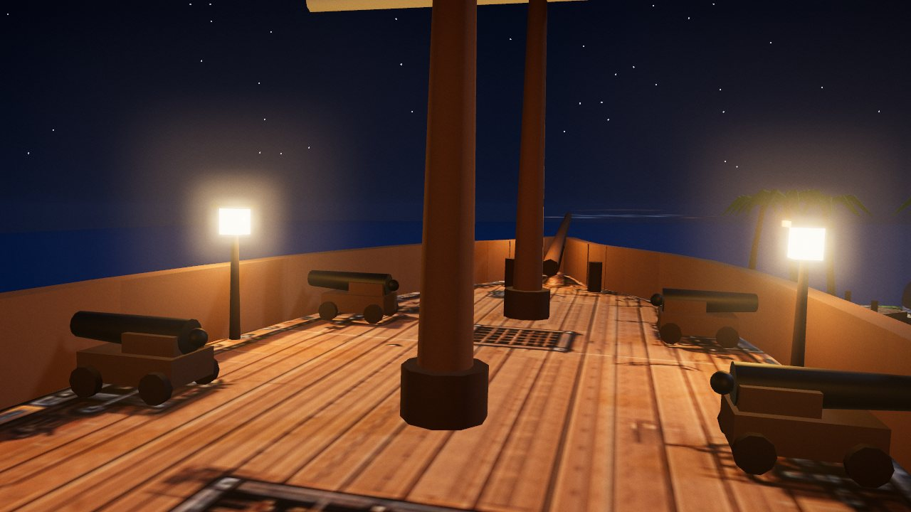
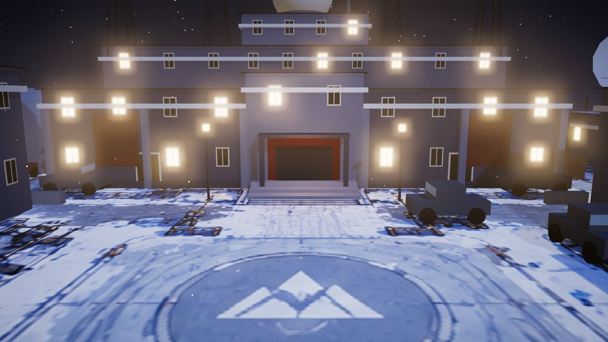
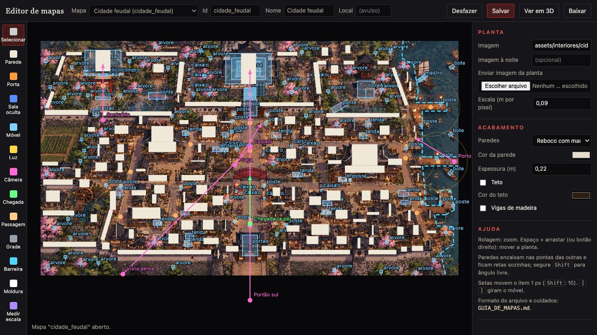

# Projeto 3SEED — mapas 3D para RPG de mesa


Um programa no navegador que transforma a imagem de uma planta, de um navio ou de uma cidade num **mapa 3D para jogar RPG de mesa**: câmeras de cena, portas que abrem e revelam salas, dia, fim de tarde e noite com lua, névoa, luzes que acendem, e uma **segunda tela sem interface** para os jogadores. Não há instalação nem etapa de build: só o Python 3 e um navegador.

É uma **semente**: vem com o programa, um editor, ferramentas para preparar as imagens e três mapas de exemplo. Os mapas você faz com as suas imagens, no editor ou pedindo a uma IA.

- **Rodar:** `python3 servidor.py` e abrir `http://127.0.0.1:5173` (a página inicial explica tudo e tem os atalhos).
- **Programa:** `http://127.0.0.1:5173/index.html` · **Editor:** `http://127.0.0.1:5173/editor.html`
- **Formato do mapa, campo por campo:** [`GUIA_DE_MAPAS.md`](GUIA_DE_MAPAS.md)
- **Instruções para uma IA criar o mapa:** [`AGENTS.md`](AGENTS.md)

---

## Rodar

```
git clone https://github.com/Cassiano-Behemonth/Projeto-3SEED.git
cd Projeto-3SEED
python3 servidor.py
```

Abra `http://127.0.0.1:5173` no Chrome, Edge ou Firefox. A página inicial explica o programa e abre os mapas de exemplo; **Abrir o programa** leva à tela do mestre.

O servidor só serve os arquivos e deixa o editor salvar mapas na pasta `mapas/`. Ele roda só no seu computador (`127.0.0.1`).

## Na mesa: com e sem interface

O mestre usa a tela **com interface** (HUD): troca de câmera, liga a noite, abre portas, põe criaturas. O botão **Tela** abre uma segunda janela **sem interface**, que repete tudo o que o mestre vê; arraste-a para a TV ou o segundo monitor, para os jogadores. A tecla <kbd>H</kbd> também esconde a interface.

| Com interface (mestre) | Sem interface (jogadores) |
|---|---|
|  |  |
|  |  |

Na tela do mestre: à esquerda, a lista de mapas; embaixo, as câmeras do mapa (com "A pé", "Luzes" e, nos interiores, "Paredes"); no alto, névoa, neblina, dia e noite, rótulos, criaturas, o editor e a segunda tela.

A segunda tela funciona no mesmo computador e no mesmo navegador. Para mostrar em outro aparelho, compartilhe a janela dela numa chamada de vídeo.

## Controles

| Tecla | O que faz |
|---|---|
| <kbd>W</kbd> <kbd>A</kbd> <kbd>S</kbd> <kbd>D</kbd> | Andar (com <kbd>Shift</kbd>, mais rápido) |
| <kbd>Q</kbd> <kbd>E</kbd> ou botão direito | Girar e olhar em volta |
| Arrastar · rolagem | Mover a vista · aproximar e afastar |
| <kbd>Espaço</kbd> · <kbd>Shift</kbd> + <kbd>Espaço</kbd> | Subir · descer a câmera |
| <kbd>C</kbd> | Próxima câmera do mapa |
| <kbd>F</kbd> | Descer "a pé", na altura dos olhos |
| <kbd>N</kbd> | Dia e noite |
| <kbd>P</kbd> | Acender e apagar as luzes |
| <kbd>T</kbd> | Paredes altas ou baixas (nos interiores) |
| <kbd>[</kbd> <kbd>]</kbd> | Menos e mais névoa |
| <kbd>H</kbd> | Esconder a interface |
| Clique | Abrir e fechar portas; seguir uma passagem (o marcador na porta de um prédio leva a outro mapa, com a animação de uma porta abrindo no escuro) |

## Como funciona

Cada mapa é uma **imagem vista de cima**, que vira o chão, mais um **arquivo** (`mapas/<nome>.json`) que diz o que fica em 3D por cima dela: paredes, portas, salas ocultas, móveis, luzes, prédios, árvores, cercas, câmeras e passagens para outros mapas. As posições são lidas na própria imagem, em pixels; os tamanhos são em metros.

| A imagem vira o chão | O clima muda o mapa |
|---|---|
|  |  |

O editor desenha tudo isso por cima da imagem e grava o arquivo; um arquivo escrito à mão (ou por uma IA) abre no editor para ajustes, e vice-versa.



## Mapas de exemplo

| Mapa | O que mostra |
|---|---|
| `navio_pirata` | Navio visto de cima: casco e tombadilho como pisos elevados que balançam, mastros com velas, canhões, cais, água que se mexe |
| `base_artica` | Base inteira vista do alto: prédios, hangares, muralha, torres, contêineres, veículos, neve; janelas que acendem à noite |
| `cidade_feudal` | Cidade inteira com mais de 200 peças: castelo, pagode, casas, muralhas, pontes, cais, cerejeiras |

Os três estão em `mapas/` e são o melhor lugar para ver como se escreve um mapa.

---

Daqui para baixo, o guia para **criar mapas**: o que preparar, em que ordem e onde estão os detalhes.

## 1. Antes de tudo: o mapa nasce das imagens

A imagem é o piso do mapa, e as peças 3D entram por cima dela. **A qualidade do mapa depende mais das imagens do que de qualquer ferramenta.** Uma pintura só, inclinada, com chão, prédios e rótulos misturados, sempre dá remendos e fachadas borradas.

Escolha o caso e prepare as imagens dele:

| O que você quer | O que pedir à IA de imagem | Onde guardar |
|---|---|---|
| **Um interior** (casa, escola, bunker, andar de prédio) | A planta vista **reta de cima**, mostrando o piso e o topo das paredes. Se tiver versão de noite, com o mesmo enquadramento. | `assets/interiores/` |
| **Uma cena ao ar livre pequena** (navio, cais, acampamento, clareira) | A cena vista **reta de cima**. | `assets/interiores/` |
| **Uma cidade, vila, base ou bairro inteiro** | **Em camadas**, veja abaixo. | veja abaixo |

### Cidade inteira: peça em camadas

Este é o caso que mais erra quando se pede uma imagem só. Peça, nesta ordem:

1. **A camada de baixo — o chão limpo.** O lugar inteiro visto exatamente de cima, só com o que é chão: ruas, calçadas, faixas, grama, terra, água, e uma **laje vazia no formato de cada prédio**. Nada com altura: sem prédios, árvores, postes, carros, cercas, rótulos ou sombras.
   → `assets/interiores/<id>_chao.png`
2. **Uma folha para cada construção importante**, com **frente, lateral, fundos e telhado** visto de cima, lado a lado, sem perspectiva, sobre fundo liso.
   → `assets/predios/<nome>.png`
3. **Um atlas de texturas** (opcional, mas recomendado): tijolo, pedra, ardósia, telha, sebe, asfalto, grama, vistos de frente e prontos para repetir.
   → `assets/texturas/<nome>.png`
4. **Pedaços de chão especiais** (opcional): o pátio de uma subestação, a planta de uma ruína, uma praça. Viram decalques sobre o chão.
   → `assets/predios/<nome>.png`

Casas pequenas e repetidas não precisam de folha: viram blocos simples com as texturas do atlas, um por casa (a IA escreve cada um; se o chão limpo tiver a laje da casa, ela usa a laje).


---

## 2. Pedidos prontos para a IA de imagem

Anexe sempre a imagem de referência (o rascunho ou a pintura que você já tem), para o estilo e a posição das coisas baterem. Os pedidos abaixo já trazem as exigências que evitam os defeitos mais comuns; não corte essas partes.

### Chão limpo (cidade inteira)

```
Use a imagem anexada como referência de layout. Gere o MESMO lugar, com as mesmas
ruas, quarteirões, caminhos, lagos e pontes nas mesmas posições, mas:

- vista ortográfica, perfeitamente de cima (90 graus), sem perspectiva e sem inclinação;
- SOMENTE o chão: asfalto, calçadas, faixas de pedestre, estacionamentos, grama, terra,
  água, pisos de pátio e caminhos;
- REMOVA tudo o que tem altura: prédios, casas, torres, árvores, sebes, postes, cercas,
  carros e pontes. Onde havia um prédio, pinte uma laje vazia de concreto ou terra
  batida no formato exato da base dele;
- sem rótulos, sem textos, sem bússola, sem moldura, sem título;
- sem sombras projetadas; luz uniforme e suave;
- mesmo estilo de pintura e mesma paleta;
- proporção 16:9, na maior resolução possível (4K ou mais).
```

### Folha de uma construção

Repita trocando o nome da construção.

```
Use a imagem anexada como referência. Crie uma folha de referência arquitetônica do
prédio "[NOME]", no mesmo estilo de pintura e com os mesmos materiais e cores.

A folha tem quatro vistas ortográficas, sem perspectiva, numa única fileira, da esquerda
para a direita: 1. FRENTE  2. LATERAL DIREITA  3. FUNDOS  4. TELHADO visto exatamente de cima.

Regras obrigatórias:
- fundo cinza médio, liso e uniforme, sem degradê, sem névoa, sem textura;
- NÃO inclua a imagem de referência nem pedaços dela no fundo ou entre as vistas;
- sem textos, rótulos, números, cotas, bússola, linha de chão ou sombra no chão;
- cada vista inteira, do chão ao topo, sem cortar torres, agulhas, chaminés ou a base;
- frente, lateral e fundos com exatamente a mesma altura e alinhados pela base;
- frente e fundos com a mesma largura; a largura da lateral igual à profundidade do
  telhado; o telhado com a frente do prédio virada para baixo;
- sem pessoas, carros, árvores ou postes encostados no prédio;
- alta resolução.
```

### Atlas de texturas

```
No mesmo estilo de pintura da imagem anexada, crie uma folha com oito texturas vistas
de frente, sem perspectiva, cada uma num quadrado do mesmo tamanho, em duas fileiras,
separadas por fundo cinza liso, preparadas para repetir sem emenda: tijolo envelhecido,
pedra com musgo, ardósia, telha de barro, asfalto rachado, calçamento de pedra, grama
escura e sebe. Sem textos e sem sombras.
```

### Interior

```
Use a imagem anexada como referência. Gere a planta deste lugar vista perfeitamente de
cima (90 graus), sem perspectiva: o piso, os móveis vistos de cima e o topo das paredes,
com as portas visíveis como vãos. Sem rótulos, sem textos, sem moldura, sem sombras
projetadas. Mesmo estilo de pintura. Alta resolução.
```

Para a versão de noite, peça a mesma imagem "com exatamente o mesmo enquadramento e as mesmas posições, só com a iluminação noturna".

### Antes de usar, confira a imagem

A IA de imagem erra de jeitos previsíveis. Olhe cada imagem antes de começar:

| Defeito | Como aparece | O que fazer |
|---|---|---|
| Layout mudou | Ruas e quarteirões em outro lugar que no rascunho | Peça de novo, ou aceite o layout novo e posicione os prédios por ele |
| Referência vazou | Pedaços do mapa ou de rótulos no fundo da folha | `folha.py --limpar` (veja o guia) ou peça de novo |
| Névoa ou degradê no fundo | Fundo borrado em volta das vistas | `folha.py --limpar --nevoa 6` |
| Vista cortada | Falta a base ou a ponta de uma torre | Peça de novo; cortado sempre fica estranho |
| Coisas por cima da fachada | Carros, postes, rótulos na frente do prédio | `apagar.py --colar` com um pedaço limpo da fachada, ou peça de novo |
| Vistas incoerentes | A lateral não tem a largura da profundidade do telhado | Dê a profundidade à mão no mapa |
| Linha de chão | Um traço sob cada vista | `folha.py --pecas` acha as vistas; tire a linha do retângulo |
| Quadrícula | Grade de mapa de batalha por cima do chão | Peça sem grade ("sem quadrícula, sem grid") ou tire com `quadricula.py` |
| Folha em pergaminho | Moldura, manchas e rótulos em volta das vistas | `folha.py --limpar ... --papel`, um retângulo por vista |
| Lateral espelhada | Na lateral direita, a varanda ou a escada aparece do lado de trás | `folha.py --limpar ... --espelhar` naquela vista |
| Duas laterais, nenhum telhado | A quarta vista tem a altura das fachadas | Use só frente, lado e fundos (`folha.py` avisa) |

Sair limpa da IA de imagem é sempre melhor que limpar depois.

---

## 3. Criar o mapa

### Pedindo a uma IA

Coloque as imagens nas pastas da tabela da seção 1 e peça o mapa. A IA segue `AGENTS.md`, usa as ferramentas e entrega uma primeira versão com uma lista do que é chute. Ela recusa ilustrações vistas de dentro (com teto, horizonte ou ponto de fuga), porque não servem de piso.

### À mão, no editor

Abra o editor, envie a imagem, meça a escala com "Medir escala" e desenhe paredes, portas, salas ocultas, móveis, luzes, câmeras, a chegada e as passagens. O editor ainda não edita folhas, decalques, prédios nem pisos elevados (só os preserva); esses entram escrevendo o arquivo.

### Ferramentas

Todas em `ferramentas/`, só com Python padrão. Cada uma explica o uso com `--help`.

| Ferramenta | Para que serve |
|---|---|
| `grade.py` | Grade numerada sobre a imagem, para ler as posições; informa a cor da borda |
| `folha.py` | Acha as vistas de uma folha de prédio, em uma ou duas fileiras, e diz qual é qual; avisa quando as medidas não combinam; `--pecas` para folhas modulares (tira as etiquetas de número); limpa folhas sujas (`--limpar`, `--nevoa`) |
| `espalhar.py` | Espalha mata onde o chão é verde e leva postes para a calçada, sem tampar câmeras |
| `endireitar.py` | Endireita planta em perspectiva e corrige vista oblíqua |
| `apagar.py` | Remenda a pintura: apaga com o piso vizinho, cobre com um "print" de outro trecho, cola pedaços, tira do chão a pintura dos prédios |
| `relevo.py` | Ergue em blocos o que tem certa cor (sebes de labirinto, muretas, canteiros) |
| `comparar.py` | Confere se dia e noite têm o mesmo enquadramento |
| `quadricula.py` | Tira a grade de mapa de batalha da pintura |
| `ampliar.py` | Aumenta o chão em volta da pintura (mapa maior, mata em volta) |
| `validar.py` | Aponta erros e avisos do arquivo do mapa |
| `previa.py` | Desenha o mapa por cima da imagem, em 2D |
| `foto.py` | Tira fotos do mapa em 3D sem abrir janela (precisa do Chrome) |

**A foto em 3D é a conferência que vale.** A prévia mostra se as peças estão no lugar; só a foto mostra se o mapa ficou bom. Tire a vista de planta e algumas do chão a cada mudança.

---

## 4. Regras que aprendemos fazendo

- **Tamanho dos prédios pelo chão.** Com chão limpo, cada prédio ocupa a laje pintada para ele: posição, largura e profundidade saem da laje.
- **Não force a altura.** Fixar a altura de um prédio largo achata a arte; deixe a altura sair da proporção do desenho. Se o prédio ficar grande demais, prefira deixar sobra de laje a esticar.
- **Postes e lanternas na calçada**, nunca no asfalto nem no meio de um cruzamento.
- **Câmeras fora de peças:** o validador avisa de câmera dentro de prédio e de árvore ou poste logo na frente dela.
- **Use os pacotes de textura.** Pedra, arenito, paralelepípedo, telha e ardósia fotográficos já vêm no projeto: portão, chafariz e muros ficam bem melhores com eles do que em cor lisa.
- **Escada no pé do prédio fica pintada.** Feita em volume, ela vira um degrau quadrado da largura do prédio.
- **Torre, chaminé ou anexo ao lado do prédio** é uma peça separada, no lugar que a vista do telhado mostra.
- **Mudança no programa vale para todos os mapas.** Antes de entregar uma mudança no jeito de montar prédios, fotografe todos os prédios de frente, não só o que motivou a mudança.

---

---

## 5. Seus mapas, criaturas e campanha

- **Seus mapas** ficam em `mapas/` e na lista `mapas/indice_local.json` (o editor faz isso ao salvar; crie com `{"mapas": []}` se for escrever à mão). Essa lista e os mapas dela ficam **fora do git**: são seus. `mapas/indice.json` é só a dos exemplos.
- **Imagens dos seus mapas** vão em `assets/interiores/`, `assets/predios/` e `assets/texturas/`; também ficam fora do git (só as dos exemplos e as texturas fotográficas vão no repositório).
- **Sons** não vêm junto. O programa toca, se existirem, `assets/sons/porta.mp3`, `tranca.mp3`, `lanterna.mp3`, `luz_acende.mp3` e `luz_apaga.mp3`; sem eles, tudo funciona em silêncio.
- **Criaturas** (figuras em pé que o mestre arrasta pelo mapa) e uma **campanha** inteira entram por um arquivo opcional, `src/campanha.js`, que também fica fora do git. O mínimo, só com criaturas:

```js
// src/campanha.js (opcional; tudo aqui é opcional)
export const NOME = 'Minha campanha';      // título na tela do mestre
export const MONSTROS = [
  // vídeo .webm com fundo transparente em assets/monstros/; "real" é a altura em metros dentro dos mapas
  { id: 'vulto', nome: 'Vulto', arquivo: 'vulto.webm', altura: 2.6, real: 1.9 },
];
```

Com esse arquivo, o botão **Criaturas** passa a listar as suas. Uma campanha completa pode trazer também uma cidade própria, com locais e interiores escritos em código (`LOCAIS`, `INTERIORES`, `HOTSPOTS_CIDADE`, `montarCidade`, `criarArvores`); sem cidade, o programa abre direto nos mapas. Os atalhos da página inicial abrem cada exemplo sozinho (`?mapa=<id>&so=1`), sem a campanha.

## 6. Limitações conhecidas

- A segunda tela só espelha a do mestre no mesmo computador e navegador.
- Não há terreno inclinado de verdade: um morro se faz com camadas de piso elevado com `encosta` (veja o guia), e não há piso rebaixado.
- A porta que abre é sempre uma folha maciça; uma porteira vazada ainda não existe.
- Prédios feitos com uma folha de vistas saem com o telhado em degraus, e o topo de um prédio com muitas torres fica confuso visto de cima.
- Num mapa muito grande, a vista de planta some na névoa: baixe a neblina no controle da tela.
- O editor ainda não edita folhas, decalques, prédios nem pisos elevados (só os preserva); esses entram escrevendo o arquivo.

## Licença

[MIT](LICENSE). Usa o [three.js](https://threejs.org) (MIT, em `vendor/three/`) e texturas fotográficas do [Poly Haven](https://polyhaven.com) (CC0).
