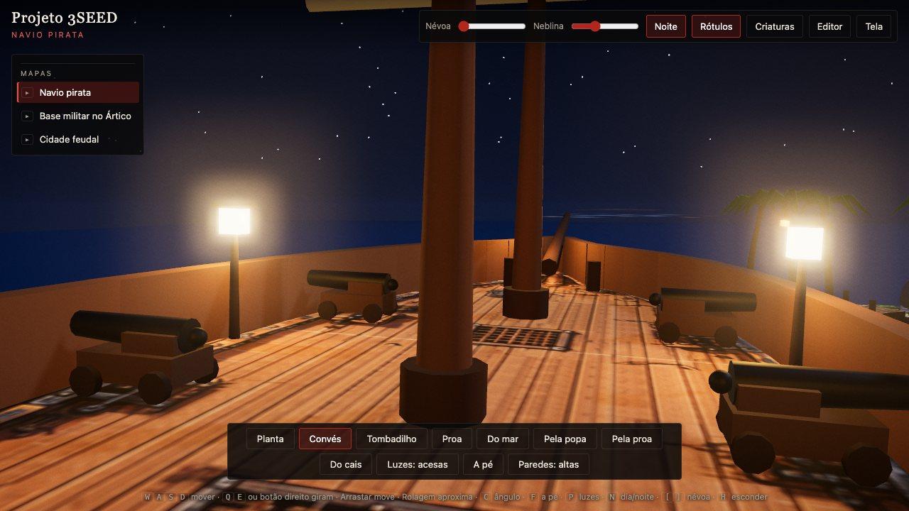
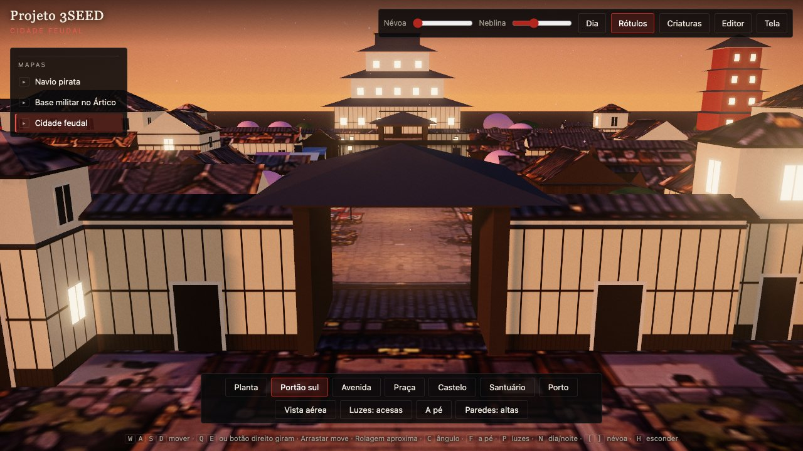
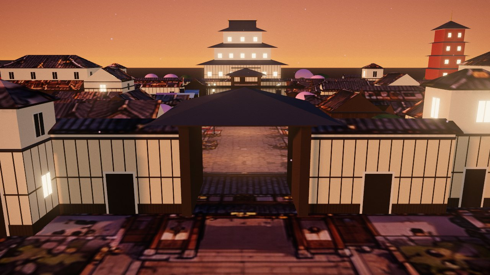
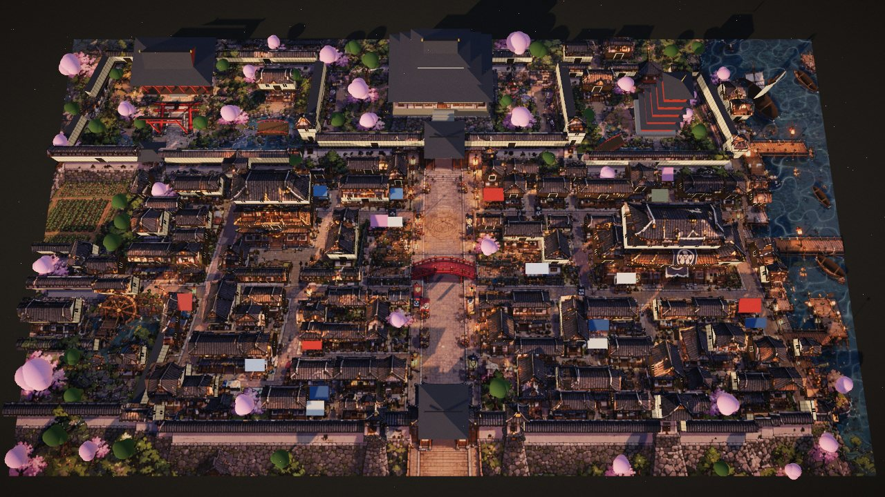

# Projeto 3SEED — mapas 3D para RPG de mesa



Um programa no navegador que transforma a imagem de uma planta, de um navio ou de uma cidade num **mapa 3D para jogar RPG de mesa**: câmeras de cena, portas que abrem e revelam salas, dia, fim de tarde e noite com lua, névoa, luzes que acendem, e uma **segunda tela sem interface** para os jogadores. Não há instalação nem etapa de build: só o Python 3 e um navegador.

É uma **semente**: vem com o programa, um editor, ferramentas para preparar as imagens e três mapas de exemplo. Os mapas você faz com as suas imagens, no editor ou pedindo a uma IA.

- **Rodar:** `python3 servidor.py` e abrir `http://127.0.0.1:5173` (a página inicial explica tudo e tem os atalhos).
- **Programa:** `http://127.0.0.1:5173/index.html` · **Editor:** `http://127.0.0.1:5173/editor.html`
- **Formato do mapa, campo por campo:** [`GUIA_DE_MAPAS.md`](GUIA_DE_MAPAS.md)
- **Instruções para uma IA criar o mapa:** [`AGENTS.md`](AGENTS.md)

---

## Rodar

```
git clone https://github.com/Cassiano-Behemonth/Projeto-3SEED.git
cd Projeto-3SEED
python3 servidor.py
```

Abra `http://127.0.0.1:5173` no Chrome, Edge ou Firefox. A página inicial explica o programa e abre os mapas de exemplo; **Abrir o programa** leva à tela do mestre.

- **Windows:** troque `python3` por `py` em todos os comandos (o `py` vem com o Python do [python.org](https://www.python.org)).
- **Porta ocupada:** se outro programa já usa a 5173, o servidor pega a próxima livre e diz qual (`http://127.0.0.1:5174`, por exemplo). Para escolher: `python3 servidor.py 8080`.
- **Mais rápido:** as ferramentas só precisam do Python. Com o [numpy](https://numpy.org) e o [Pillow](https://python-pillow.org) instalados (`python3 -m pip install numpy pillow`), as mais pesadas ficam de 5 a 10 vezes mais rápidas, com o mesmo resultado.

O servidor só serve os arquivos e deixa o editor salvar mapas na pasta `mapas/`. Ele roda só no seu computador (`127.0.0.1`).

## Na mesa: com e sem interface

O mestre usa a tela **com interface** (HUD): troca de câmera, liga a noite, abre portas, põe criaturas. O botão **Tela** abre uma segunda janela **sem interface**, que repete tudo o que o mestre vê; arraste-a para a TV ou o segundo monitor, para os jogadores. A tecla <kbd>H</kbd> também esconde a interface.

| Com interface (mestre) | Sem interface (jogadores) |
|---|---|
|  |  |
|  |  |

Na tela do mestre: à esquerda, a lista de mapas; embaixo, as câmeras do mapa (com "A pé", "Luzes" e, nos interiores, "Paredes"); no alto, névoa, neblina, dia e noite, rótulos, criaturas, o editor, a segunda tela e o vídeo de fundo do projetor (se houver).

A segunda tela funciona no mesmo computador e no mesmo navegador. Para mostrar em outro aparelho, compartilhe a janela dela numa chamada de vídeo.

**Dia, fim de tarde e noite.** A barra **Dia — Noite** no alto vai do dia (esquerda) à noite (direita); no meio ela gruda no **fim de tarde** (sol baixo e alaranjado, luzes acendendo). O botão ao lado (e a tecla <kbd>N</kbd>) troca direto entre dia e noite, com uma transição animada. Cada mapa abre na hora que ele pede (`hora` no arquivo); ao trocar de mapa, vale a hora do mapa novo.

**O que você põe na mesa fica guardado.** Criaturas e objetos colocados, portas abertas, salas reveladas, desafios feitos, clima, névoa e luzes são gravados no navegador a cada segundo e meio e voltam se a página recarregar (ou o navegador fechar sem querer). Para começar do zero, abra com `?limpo=1` no endereço (`http://127.0.0.1:5173/?limpo=1`). Fica guardado só neste navegador: outro computador começa vazio.

### Vídeo de fundo no projetor

O botão **Fundo** (no alto, ao lado de Tela) abre um menu de vídeos para outra janela, feita para o projetor: só o vídeo, sem som e sem interface. Clique num vídeo e a janela abre já nele. Arraste-a para o projetor e dê dois cliques nela (ou aperte <kbd>F</kbd>) para a tela cheia. Daí em diante, cada clique no menu troca o vídeo com uma mistura de 1,5 s, sem tela preta. O primeiro vídeo da lista é o fundo de base e repete sempre. Os outros passam uma vez e voltam sozinhos para ele, a não ser que o quadradinho **repete** ao lado esteja marcado: aí ficam repetindo, misturando o fim com o começo, até você trocar. O quadradinho vale na hora, até para o vídeo que está passando, e o menu lembra o que estava marcado. Como a segunda tela, funciona no mesmo computador e no mesmo navegador.

O botão só aparece se existir `assets/videos/fundos.json` (fica fora do git, com os vídeos):

```json
{
  "fundos": [
    { "nome": "Sem nada", "arquivo": "vento.mp4" },
    { "nome": "Urso", "arquivo": "urso.mp4", "comecaParado": true },
    { "nome": "Atrás da árvore", "arquivo": "machado.mp4", "comecaParado": true, "repetirDe": 2.8 }
  ]
}
```

- `arquivo`: o vídeo, na mesma pasta (MP4 ou WebM).
- `comecaParado`: para quando algo entra em cena logo no começo do vídeo. Na mistura, o primeiro quadro aparece parado e o vídeo só anda quando já cobre a tela; sem isso, o bicho entra transparente.
- `repetirDe`: com "repete" marcado, o segundo em que as repetições recomeçam; o começo passa só na primeira vez. Serve para quem entra em cena e fica.

A troca fica mais bonita quando os vídeos têm o mesmo cenário e o mesmo enquadramento: aí só o que se mexe aparece ou some.

## Controles

| Tecla | O que faz |
|---|---|
| <kbd>W</kbd> <kbd>A</kbd> <kbd>S</kbd> <kbd>D</kbd> | Andar (com <kbd>Shift</kbd>, mais rápido) |
| <kbd>Q</kbd> <kbd>E</kbd> ou botão direito | Girar e olhar em volta |
| Arrastar · rolagem | Mover a vista · aproximar e afastar |
| <kbd>Espaço</kbd> · <kbd>Shift</kbd> + <kbd>Espaço</kbd> | Subir · descer a câmera |
| <kbd>C</kbd> | Próxima câmera do mapa |
| <kbd>F</kbd> | Descer "a pé", na altura dos olhos |
| <kbd>N</kbd> | Dia e noite |
| <kbd>P</kbd> | Acender e apagar as luzes |
| <kbd>T</kbd> | Paredes altas ou baixas (nos interiores) |
| <kbd>[</kbd> <kbd>]</kbd> | Menos e mais névoa |
| <kbd>H</kbd> | Esconder a interface |
| Clique | Abrir e fechar portas; seguir uma passagem (o marcador na porta de um prédio leva a outro mapa, com a animação de uma porta abrindo no escuro) |

## Como funciona

Cada mapa é uma **imagem vista de cima**, que vira o chão, mais um **arquivo** (`mapas/<nome>.json`) que diz o que fica em 3D por cima dela: paredes, portas, salas ocultas, móveis, luzes, prédios, árvores, cercas, câmeras e passagens para outros mapas. As posições são lidas na própria imagem, em pixels; os tamanhos são em metros.

| A imagem vira o chão | O clima muda o mapa |
|---|---|
|  |  |

O editor desenha tudo isso por cima da imagem e grava o arquivo; um arquivo escrito à mão (ou por uma IA) abre no editor para ajustes, e vice-versa.


## Mapas de exemplo

| Mapa | O que mostra |
|---|---|
| `navio_pirata` | Navio visto de cima: casco e tombadilho como pisos elevados que balançam, mastros com velas, canhões, cais, água que se mexe |
| `base_artica` | Base inteira vista do alto: prédios, hangares, muralha, torres, contêineres, veículos, neve; janelas que acendem à noite |
| `cidade_feudal` | Cidade inteira com mais de 200 peças: castelo, pagode, casas, muralhas, pontes, cais, cerejeiras |

Os três estão em `mapas/` e são o melhor lugar para ver como se escreve um mapa.

---

Daqui para baixo, o guia para **criar mapas**: o que preparar, em que ordem e onde estão os detalhes.

## 1. Antes de tudo: o mapa nasce das imagens

A imagem é o piso do mapa, e as peças 3D entram por cima dela. **A qualidade do mapa depende mais das imagens do que de qualquer ferramenta.** Uma pintura só, inclinada, com chão, prédios e rótulos misturados, sempre dá remendos e fachadas borradas.

Escolha o caso e prepare as imagens dele:

| O que você quer | O que pedir à IA de imagem | Onde guardar |
|---|---|---|
| **Um interior** (casa, escola, bunker, andar de prédio) | A planta vista **reta de cima**, mostrando o piso e o topo das paredes. Se tiver versão de noite, com o mesmo enquadramento. | `assets/interiores/` |
| **Uma cena ao ar livre pequena** (navio, cais, acampamento, clareira) | A cena vista **reta de cima**. | `assets/interiores/` |
| **Uma cidade, vila, base ou bairro inteiro** | **Em camadas**, veja abaixo. | veja abaixo |

### Cidade inteira: peça em camadas

Este é o caso que mais erra quando se pede uma imagem só. Peça, nesta ordem:

1. **A camada de baixo — o chão limpo.** O lugar inteiro visto exatamente de cima, só com o que é chão: ruas, calçadas, faixas, grama, terra, água, e uma **laje vazia no formato de cada prédio**. Nada com altura: sem prédios, árvores, postes, carros, cercas, rótulos ou sombras.
   → `assets/interiores/<id>_chao.png`
2. **Uma folha para cada construção importante**, com **frente, lateral, fundos e telhado** visto de cima, lado a lado, sem perspectiva, sobre fundo liso.
   → `assets/predios/<nome>.png`
3. **Um atlas de texturas** (opcional, mas recomendado): tijolo, pedra, ardósia, telha, sebe, asfalto, grama, vistos de frente e prontos para repetir.
   → `assets/texturas/<nome>.png`
4. **Pedaços de chão especiais** (opcional): o pátio de uma subestação, a planta de uma ruína, uma praça. Viram decalques sobre o chão.
   → `assets/predios/<nome>.png`

Casas pequenas e repetidas não precisam de folha: viram blocos simples com as texturas do atlas, um por casa (a IA escreve cada um; se o chão limpo tiver a laje da casa, ela usa a laje).


---

## 2. Pedidos prontos para a IA de imagem

Anexe sempre a imagem de referência (o rascunho ou a pintura que você já tem), para o estilo e a posição das coisas baterem. Os pedidos abaixo já trazem as exigências que evitam os defeitos mais comuns; não corte essas partes.

### Chão limpo (cidade inteira)

```
Use a imagem anexada como referência de layout. Gere o MESMO lugar, com as mesmas
ruas, quarteirões, caminhos, lagos e pontes nas mesmas posições, mas:

- vista ortográfica, perfeitamente de cima (90 graus), sem perspectiva e sem inclinação;
- SOMENTE o chão: asfalto, calçadas, faixas de pedestre, estacionamentos, grama, terra,
  água, pisos de pátio e caminhos;
- REMOVA tudo o que tem altura: prédios, casas, torres, árvores, sebes, postes, cercas,
  carros e pontes. Onde havia um prédio, pinte uma laje vazia de concreto ou terra
  batida no formato exato da base dele;
- sem rótulos, sem textos, sem bússola, sem moldura, sem título;
- sem sombras projetadas; luz uniforme e suave;
- mesmo estilo de pintura e mesma paleta;
- proporção 16:9, na maior resolução possível (4K ou mais).
```

### Folha de uma construção

Repita trocando o nome da construção.

```
Use a imagem anexada como referência. Crie uma folha de referência arquitetônica do
prédio "[NOME]", no mesmo estilo de pintura e com os mesmos materiais e cores.

A folha tem quatro vistas ortográficas, sem perspectiva, numa única fileira, da esquerda
para a direita: 1. FRENTE  2. LATERAL DIREITA  3. FUNDOS  4. TELHADO visto exatamente de cima.

Regras obrigatórias:
- fundo cinza médio, liso e uniforme, sem degradê, sem névoa, sem textura;
- NÃO inclua a imagem de referência nem pedaços dela no fundo ou entre as vistas;
- sem textos, rótulos, números, cotas, bússola, linha de chão ou sombra no chão;
- cada vista inteira, do chão ao topo, sem cortar torres, agulhas, chaminés ou a base;
- frente, lateral e fundos com exatamente a mesma altura e alinhados pela base;
- frente e fundos com a mesma largura; a largura da lateral igual à profundidade do
  telhado; o telhado com a frente do prédio virada para baixo;
- sem pessoas, carros, árvores ou postes encostados no prédio;
- alta resolução.
```

### Atlas de texturas

```
No mesmo estilo de pintura da imagem anexada, crie uma folha com oito texturas vistas
de frente, sem perspectiva, cada uma num quadrado do mesmo tamanho, em duas fileiras,
separadas por fundo cinza liso, preparadas para repetir sem emenda: tijolo envelhecido,
pedra com musgo, ardósia, telha de barro, asfalto rachado, calçamento de pedra, grama
escura e sebe. Sem textos e sem sombras.
```

### Interior

```
Use a imagem anexada como referência. Gere a planta deste lugar vista perfeitamente de
cima (90 graus), sem perspectiva: o piso, os móveis vistos de cima e o topo das paredes,
com as portas visíveis como vãos. Sem rótulos, sem textos, sem moldura, sem sombras
projetadas. Mesmo estilo de pintura. Alta resolução.
```

Para a versão de noite, peça a mesma imagem "com exatamente o mesmo enquadramento e as mesmas posições, só com a iluminação noturna".

### Folha de um objeto 3D (carro, carroça, armadilha, barco)

```
Crie uma folha de referência técnica do objeto "[NOME]", no estilo da imagem anexada.
Quatro vistas ortográficas, sem perspectiva, numa grade 2 x 2:
1. FRENTE (em cima, à esquerda)
2. LATERAL DIREITA, com a frente do objeto virada para a ESQUERDA (em cima, à direita)
3. FUNDOS (embaixo, à esquerda)
4. VISTA DE CIMA, com a frente do objeto virada para a ESQUERDA (embaixo, à direita)

Regras obrigatórias:
- fundo cinza médio, liso e uniforme, sem degradê, sem sombra no chão;
- frente, lateral e fundos com exatamente a mesma altura e alinhados pela base;
- o comprimento da lateral igual ao comprimento da vista de cima, e a largura da
  frente igual à largura da vista de cima;
- cada vista inteira, sem cortar nada; sem textos, rótulos, cotas nem linhas de chão;
- alta resolução.
```

### Folha de um personagem ou criatura

```
Crie uma folha de personagem de "[NOME]", no estilo da imagem anexada, com seis poses
de corpo inteiro numa grade 3 x 2, todas na MESMA ESCALA (a mesma altura de pessoa em
todas): 1. parado de frente  2. andando de lado, virado para a DIREITA  3. agachado
4. investigando  5. lutando  6. de costas.

Regras obrigatórias:
- fundo liso e uniforme, de uma cor que não aparece no personagem (cinza claro ou verde);
- cada pose inteira, da cabeça aos pés, sem cortar nada, sem encostar na vizinha;
- sem textos, rótulos, sombra no chão nem cenário;
- iluminação igual em todas as poses;
- alta resolução.
```

Para um bicho, troque as poses (parado, andando, comendo, alerta, atacando, deitado). Para o personagem que o programa vira sozinho conforme a câmera (seção 6), peça também as quatro diagonais: frente-direita, frente-esquerda, costas-direita, costas-esquerda.

### Antes de usar, confira a imagem

A IA de imagem erra de jeitos previsíveis. Olhe cada imagem antes de começar:

| Defeito | Como aparece | O que fazer |
|---|---|---|
| Layout mudou | Ruas e quarteirões em outro lugar que no rascunho | Peça de novo, ou aceite o layout novo e posicione os prédios por ele |
| Referência vazou | Pedaços do mapa ou de rótulos no fundo da folha | `folha.py --limpar` (veja o guia) ou peça de novo |
| Névoa ou degradê no fundo | Fundo borrado em volta das vistas | `folha.py --limpar --nevoa 6` |
| Vista cortada | Falta a base ou a ponta de uma torre | Peça de novo; cortado sempre fica estranho |
| Coisas por cima da fachada | Carros, postes, rótulos na frente do prédio | `apagar.py --colar` com um pedaço limpo da fachada, ou peça de novo |
| Vistas incoerentes | A lateral não tem a largura da profundidade do telhado | Dê a profundidade à mão no mapa |
| Linha de chão | Um traço sob cada vista | `folha.py --pecas` acha as vistas; tire a linha do retângulo |
| Quadrícula | Grade de mapa de batalha por cima do chão | Peça sem grade ("sem quadrícula, sem grid") ou tire com `quadricula.py` |
| Folha em pergaminho | Moldura, manchas e rótulos em volta das vistas | `folha.py --limpar ... --papel`, um retângulo por vista |
| Lateral espelhada | Na lateral direita, a varanda ou a escada aparece do lado de trás | Confira com `folha.py --alinhar`; desvire com `folha.py --limpar ... --espelhar` naquela vista |
| Duas laterais, nenhum telhado | A quarta vista tem a altura das fachadas | Use só frente, lado e fundos (`folha.py` avisa) |
| Chaminé ou torre fora do lugar | Na frente a chaminé está à esquerda; no telhado, à direita | `folha.py --alinhar`; corrija a folha ou peça de novo, senão ela aparece repetida no 3D |

Sair limpa da IA de imagem é sempre melhor que limpar depois.

---

## 3. Criar o mapa

### Pedindo a uma IA

Coloque as imagens nas pastas da tabela da seção 1 e peça o mapa. A IA segue `AGENTS.md`, usa as ferramentas e entrega uma primeira versão com uma lista do que é chute. Ela recusa ilustrações vistas de dentro (com teto, horizonte ou ponto de fuga), porque não servem de piso.

### À mão, no editor

Abra o editor, envie a imagem, meça a escala com "Medir escala" e desenhe paredes, portas, salas ocultas, móveis, luzes, câmeras, a chegada e as passagens. O editor ainda não edita folhas, decalques, prédios nem pisos elevados (só os preserva); esses entram escrevendo o arquivo.

### Ferramentas

Todas em `ferramentas/`, só com Python padrão (com numpy e Pillow, mais rápidas). Cada uma explica o uso com `--help`. As imagens de conferência que elas gravam vão bem em `rascunho/`, uma pasta que fica fora do git.

| Ferramenta | Para que serve |
|---|---|
| `grade.py` | Grade numerada sobre a imagem, para ler as posições; informa a cor da borda |
| `folha.py` | Acha as vistas de uma folha de prédio, em uma ou duas fileiras, e diz qual é qual; avisa quando as medidas não combinam; `--pecas` para folhas modulares (tira as etiquetas de número); limpa folhas sujas (`--limpar`, `--nevoa`, `--papel`); `--alinhar` põe o telhado em cima de cada vista para conferir lateral espelhada e chaminé fora do lugar |
| `compor.py` | Monta um chão grande com pedaços de uma pintura espalhados e ligados por trilhas (afastar as partes de um lugar sem mudar a escala) |
| `figuras.py` | Recorta as poses de uma folha de personagem ou criatura, uma PNG por pose com fundo transparente, e imprime o trecho para a campanha (seção 6) |
| `objeto.py` | Monta o atlas de um objeto 3D (carro, armadilha) a partir de uma folha de quatro vistas e imprime o trecho `volume` (seção 6) |
| `espalhar.py` | Espalha mata onde o chão é verde e leva postes para a calçada, sem tampar câmeras |
| `endireitar.py` | Endireita planta em perspectiva e corrige vista oblíqua |
| `apagar.py` | Remenda a pintura: apaga com o piso vizinho, cobre com um "print" de outro trecho, cola pedaços, tira do chão a pintura dos prédios |
| `relevo.py` | Ergue em blocos o que tem certa cor (sebes de labirinto, muretas, canteiros) |
| `comparar.py` | Confere se dia e noite têm o mesmo enquadramento |
| `quadricula.py` | Tira a grade de mapa de batalha da pintura (`--maximo 150` para grade escura) |
| `ampliar.py` | Aumenta o chão em volta da pintura (mapa maior, mata em volta) |
| `validar.py` | Aponta erros e avisos do arquivo do mapa: campos com valor errado, imagens que faltam, peças, câmeras e chegada fora da área em que se anda, desafios incompletos, criaturas que não existem. `--tudo` confere todos os mapas e as listas (arquivo listado que não existe, `id` repetido, mapa fora das listas) |
| `validar_campanha.py` | Confere a campanha (`src/campanha.js`): imagens e vídeos que faltam, medidas que não batem, poses que não existem, campos com nome errado (o mesmo que abrir `conferir.html`) |
| `testar.py` | Testa as ferramentas e o programa de ponta a ponta, em imagens de teste e no navegador. Rode antes de publicar uma mudança |
| `previa.py` | Desenha o mapa por cima da imagem, em 2D |
| `foto.py` | Tira fotos do mapa em 3D sem abrir janela (precisa do Chrome); `--espera 600` para mapas enormes, `--porta` se a 5173 estiver ocupada |

**A foto em 3D é a conferência que vale.** A prévia mostra se as peças estão no lugar; só a foto mostra se o mapa ficou bom. Tire a vista de planta e algumas do chão a cada mudança.

---

## 4. Regras que aprendemos fazendo

- **Tamanho dos prédios pelo chão.** Com chão limpo, cada prédio ocupa a laje pintada para ele: posição, largura e profundidade saem da laje.
- **Não force a altura.** Fixar a altura de um prédio largo achata a arte; deixe a altura sair da proporção do desenho. Se o prédio ficar grande demais, prefira deixar sobra de laje a esticar.
- **Postes e lanternas na calçada**, nunca no asfalto nem no meio de um cruzamento.
- **Câmeras fora de peças:** o validador avisa de câmera dentro de prédio e de árvore ou poste logo na frente dela.
- **Use os pacotes de textura.** Pedra, arenito, paralelepípedo, telha e ardósia fotográficos já vêm no projeto: portão, chafariz e muros ficam bem melhores com eles do que em cor lisa.
- **Escada no pé do prédio fica pintada.** Feita em volume, ela vira um degrau quadrado da largura do prédio.
- **Torre, chaminé ou anexo ao lado do prédio** é uma peça separada, no lugar que a vista do telhado mostra.
- **Mudança no programa vale para todos os mapas.** Antes de entregar uma mudança no jeito de montar prédios, fotografe todos os prédios de frente, não só o que motivou a mudança.

---

## 5. Seus mapas, criaturas e campanha

- **Seus mapas** ficam em `mapas/` e na lista `mapas/indice_local.json` (o editor faz isso ao salvar; crie com `{"mapas": []}` se for escrever à mão). Essa lista e os mapas dela ficam **fora do git**: são seus. `mapas/indice.json` é só a dos exemplos.
- **Imagens dos seus mapas** vão em `assets/interiores/`, `assets/predios/` e `assets/texturas/`; também ficam fora do git (só as dos exemplos e as texturas fotográficas vão no repositório).
- **Criaturas, personagens, objetos 3D** e uma **campanha** inteira entram por um arquivo opcional, `src/campanha.js`, que também fica fora do git. A seção 6 mostra como acrescentar cada tipo.
- **Uma campanha completa** pode trazer também uma cidade própria, com locais e interiores escritos em código (`LOCAIS`, `INTERIORES`, `HOTSPOTS_CIDADE`, `montarCidade`, `criarArvores`); sem cidade, o programa abre direto nos mapas. Os atalhos da página inicial abrem cada exemplo sozinho (`?mapa=<id>&so=1`), sem a cidade da campanha; os personagens e as criaturas dela continuam no painel.

---

## 6. Como acrescentar cada coisa

| O que | Onde fica | Como |
|---|---|---|
| Um mapa | `mapas/<id>.json`, listado em `mapas/indice_local.json` | Seções 1 a 3 e `GUIA_DE_MAPAS.md` |
| Chão, folhas de prédio, texturas | `assets/interiores/`, `assets/predios/`, `assets/texturas/` | Seção 1 |
| Mapa desenhado para os jogadores | `assets/interiores/`, com `imagemPlanta` no mapa | [Abaixo](#mapa-dos-jogadores) |
| Criatura em vídeo | `assets/monstros/<nome>.webm`, em `MONSTROS` | [Abaixo](#criatura-em-vídeo) e seção 7 |
| Figura com poses | `assets/personagens/`, em `MONSTROS` ou `PERSONAGENS` | `figuras.py`, [abaixo](#figura-com-poses) |
| Personagem que vira com a câmera | `assets/personagens/`, em `PERSONAGENS` | `figuras.py`, [abaixo](#personagem-que-vira-com-a-câmera) |
| Objeto 3D que o mestre arrasta | `assets/objetos/`, em `MONSTROS` | `objeto.py`, [abaixo](#objeto-3d) |
| Vídeo de fundo do projetor | `assets/videos/`, listado em `fundos.json` | "Vídeo de fundo no projetor", lá em cima, e seção 7 |
| Sons | `assets/sons/` | [Abaixo](#sons) e seção 7 |
| Barracas para montar, fogueira para acender | no mapa (`desafio`, `fase`, `desafios`) | "Desafios" no `GUIA_DE_MAPAS.md` |

### O arquivo da campanha

Tudo o que o mestre põe no mapa pelo botão **Criaturas** vem de `src/campanha.js`. O arquivo é opcional e cada parte dele também:

```js
// src/campanha.js
export const NOME = 'Minha campanha';   // título na tela do mestre
export const PERSONAGENS = [ /* os dos jogadores */ ];
export const MONSTROS = [ /* criaturas e objetos */ ];
```

Campos que valem para todos:

| Campo | O que é |
|---|---|
| `id` | Nome único, só letras minúsculas, números e `_`. É ele que vai no campo `criaturas` de um mapa, para limitar o painel. |
| `nome` | O que aparece no painel. |
| `real` | A altura de verdade, em metros, dentro dos mapas. |
| `altura` | A altura na cidade da campanha, exagerada para aparecer de longe. Sem cidade, use o mesmo valor de `real`. O mestre ajusta a altura de cada figura no painel. |
| `grupo` | Põe a criatura numa seção recolhida do painel, com esse título (`grupo: 'Chefes'`). Todas as do mesmo grupo ficam juntas, no fim da lista; serve para as que não se põem sem querer e para encurtar a lista. |
| `ganho` | Clareia a arte escura (1 = como está; 2 = o dobro). |
| `lanterna: true` | A figura ilumina em volta, com uma luz quente. |
| `lanternaFrente: true` | Um feixe de lanterna para a frente da figura, que vira com ela. Nasce apagado; a tecla <kbd>L</kbd> acende (com várias marcadas por <kbd>Ctrl</kbd>, acende todas). |

**Conferir a campanha:** abra `http://127.0.0.1:5173/conferir.html` ou rode `python3 ferramentas/validar_campanha.py`. Ele aponta o que faria uma figura não aparecer (imagem que falta, quadro sem `alt`, pose que não existe) e campos com nome errado. Se a campanha tiver erro, a tela do mestre também avisa, embaixo.

No mapa, o mestre clica no botão da criatura e depois no lugar onde ela nasce (<kbd>Shift</kbd> mantém o botão armado para pôr várias; <kbd>Esc</kbd> cancela), arrasta para mover, gira com a rolagem do mouse e usa o painel para altura, pose, virar e remover.

### Criatura em vídeo

Um vídeo com fundo transparente, que sempre encara a câmera. Bom para vultos, fumaça, bichos que se mexem.

1. Tenha o vídeo com fundo verde liso (ou uma sequência de PNGs com transparência).
2. Converta para WebM com transparência (receita na seção 7) e grave em `assets/monstros/vulto.webm`.
3. Acrescente em `MONSTROS`:

```js
{ id: 'vulto', nome: 'Vulto', arquivo: 'vulto.webm', altura: 1.9, real: 1.9 },
```

A transparência do WebM funciona no Chrome, no Edge e no Firefox. No Safari o fundo aparece.

### Figura com poses

Uma imagem por pose, que encara a câmera; o mestre escolhe a pose no painel, e **Virar** (<kbd>Z</kbd>/<kbd>X</kbd>) a espelha. É o jeito mais simples e o que melhor aceita arte feita por IA.

1. Peça a folha (pedido pronto na seção 2) e guarde a original fora de `assets/`.
2. Converta para PNG se precisar (seção 7) e confira o recorte:
   `python3 ferramentas/figuras.py folha.png --nome cervo --conferir rascunho/c.png`
   Abra `rascunho/c.png`: o fundo tirado aparece em rosa e cada figura numerada, na ordem de leitura. Prancha em grade (seis poses em 3 x 2): `--grade 3x2`. Fundo preso entre as pernas: `--vaos 25`. Sobrou fundo em volta: `--limite 10`; o fundo comeu o desenho: `--limite 5`.
3. Grave as PNGs com o nome de cada pose:
   `python3 ferramentas/figuras.py folha.png --nome cervo --poses parado,andando,pastando,costas --saida assets/personagens`
   Vistas de lado devem olhar para a **direita**: desvire as outras com `--virar andando`. Figuras de folhas diferentes ficam do mesmo tamanho com `--altura` (a primeira pose fica com essa altura em pixels).
4. A ferramenta imprime o trecho `quadros` e `poses`. Cole em `MONSTROS` (ou em `PERSONAGENS`):

```js
{
  id: 'cervo', nome: 'Cervo', fixo: true, altura: 2.2, real: 2.2,
  quadros: {
    parado: { arquivo: 'assets/personagens/cervo_parado.png', w: 353, h: 366, alt: 1 },
    pastando: { arquivo: 'assets/personagens/cervo_pastando.png', w: 304, h: 233, alt: 0.64 },
  },
  poses: [['parado', 'Parado'], ['pastando', 'Pastando']],
},
```

- `fixo: true` é o que faz dela uma figura de poses.
- `alt` é a altura de cada pose em relação à primeira (o bicho deitado é mais baixo). A ferramenta calcula pela folha; ajuste se as poses não foram desenhadas na mesma escala.
- `poses` é a lista do painel, na ordem; a primeira é a inicial. Os nomes da direita são os que o mestre vê.
- As figuras respiram (sobem e descem de leve). Para uma pose parada de verdade (um bicho morto), ponha `respira: false` no quadro dela.
- **Ao ser arrastada, ela troca de pose sozinha** com `poseAndar: { frente: 'andando', costas: 'costas', parado: 'parado' }`: afastando-se da câmera mostra as costas, vindo ou de lado mostra a pose de andar, e ao parar volta a `parado`. Com `diagonais: true` e mais quatro quadros (`diagFrenteD`, `diagFrenteE`, `diagCostasD`, `diagCostasE`: andando na diagonal, de frente ou de costas, para a direita ou a esquerda da tela), ela usa também as diagonais.

### Personagem que vira com a câmera

O personagem tem uma vista para cada lado e o programa escolhe a certa conforme de onde a câmera olha; a rolagem do mouse gira o personagem. Dá mais trabalho de arte (cinco vistas coerentes), mas ele parece estar no lugar.

```js
{
  id: 'explorador', nome: 'Exploradora', altura: 1.7, real: 1.7, lanterna: true,
  vistas: {
    frente:   { arquivo: 'assets/personagens/exp_frente.png',   w: 230, h: 520, alt: 1 },
    tqFrente: { arquivo: 'assets/personagens/exp_tqfrente.png', w: 250, h: 520, alt: 1 },
    perfil:   { arquivo: 'assets/personagens/exp_perfil.png',   w: 210, h: 520, alt: 1 },
    tqCostas: { arquivo: 'assets/personagens/exp_tqcostas.png', w: 250, h: 520, alt: 1 },
    costas:   { arquivo: 'assets/personagens/exp_costas.png',   w: 230, h: 520, alt: 1 },
    agachar:  { arquivo: 'assets/personagens/exp_agachar.png',  w: 300, h: 360, alt: 0.69 },
  },
  poses: [['parado', 'Parado'], ['agachar', 'Agachado']],
},
```

- As cinco primeiras são obrigatórias: de frente, três quartos de frente, de perfil, três quartos de costas e de costas. As de lado olham para a **direita**; o programa espelha quando é preciso.
- Outras vistas (`agachar` acima) são poses que o mestre escolhe no painel; `parado` é a que segue a direção.
- Com `lanterna`, cada quadro pode dizer onde a lanterna está na arte: `lu` (da esquerda, de 0 a 1) e `lv` (de baixo, de 0 a 1). A luz sai desse ponto, e não do meio da figura.
- Recorte com `figuras.py`, como na figura com poses.

### Objeto 3D

Carro, carroça, armadilha, caixote: o programa esculpe o volume pelas silhuetas de quatro vistas (frente, lateral, fundos e de cima) e pinta cada lado com a vista dele. O objeto não encara a câmera; o mestre arrasta e gira com a rolagem.

1. Peça a folha (pedido pronto na seção 2).
2. Monte o atlas e confira:
   `python3 ferramentas/objeto.py folha.png --nome carro --comprimento 4.5 --conferir rascunho/c.png`
   Na imagem, a lateral e a vista de cima ficam uma sobre a outra, na mesma largura, com linhas-guia: rodas, portas e para-brisa têm que cair nas mesmas linhas. Se não caem, desvire a lateral (`--espelhar-lado`) ou gire a vista de cima (`--cima-frente direita`). Linhas de chão e rótulos saem sozinhos; fundo preso dentro do objeto (o aro de uma armadilha) sai com `--vaos 20`.
3. Grave: acrescente `--saida assets/objetos`. A ferramenta imprime o trecho pronto.
4. Cole em `MONSTROS`:

```js
{ id: 'carro', nome: 'Carro', altura: 1.45, real: 1.45,
  volume: { comp: 4.5, larg: 1.8, alt: 1.45, atlas: 'assets/objetos/carro_atlas.png',
            F: [24, 24, 670, 499], S: [694, 24, 2038, 499], B: [24, 523, 625, 998], T: [694, 523, 2038, 1129], redondo: 0.6 } },
```

- `comp`, `larg`, `alt`: comprimento, largura e altura em metros. A ferramenta tira a largura e a altura da proporção do desenho; corrija se souber as medidas de verdade.
- `F`, `S`, `B`, `T`: onde estão a frente, a lateral, os fundos e a vista de cima dentro do atlas (não mexa).
- `redondo` (0 a 1): o quanto os cantos se arredondam vistos de cima (0,6 num carro; 0 num caixote).
- `plano: true`: objeto baixo e chato (tapete, alçapão), só a vista de cima deitada no chão.
- `cruzado: true`: objeto vazado (armadilha, cerca solta), três planos que se cruzam em vez de um volume.
- **Veículo:** `leva: ['explorador', 'guia']` (os `id` de quem ele leva, ou o nome de um `grupo`) põe no painel o botão **Embarcar**: as figuras que ele leva somem do mapa. **Desembarcar** as põe de volta em fila, ao lado dele. Ele lembra quem embarcou, mesmo se a página recarregar.

### Mapa dos jogadores

Um mapa desenhado para os jogadores (sem os segredos, com o estilo de um mapa de papel) aparece no lugar da cena quando o mestre escolhe o ângulo **Planta** daquele mapa, também na segunda tela. No arquivo do mapa:

```json
"imagemPlanta": "assets/interiores/vila_mapa_jogadores.png"
```

A imagem pode ter qualquer tamanho; ela é mostrada inteira, centralizada.

### Sons

O programa toca, se existirem, `assets/sons/porta.mp3`, `tranca.mp3`, `lanterna.mp3`, `luz_acende.mp3` e `luz_apaga.mp3`; sem eles, tudo funciona em silêncio. Use sons curtos (até 2 s), em MP3; a seção 7 mostra como converter, cortar e igualar o volume.

---

## 7. Vídeos, sons e imagens com o ffmpeg

O [ffmpeg](https://ffmpeg.org) converte e corta vídeos, sons e imagens pela linha de comando. É gratuito.

**Instalar:**

| Sistema | Comando |
|---|---|
| Mac | `brew install ffmpeg` (precisa do [Homebrew](https://brew.sh)) |
| Windows | `winget install --id Gyan.FFmpeg -e` (depois feche e abra o terminal) |
| Linux (Debian, Ubuntu) | `sudo apt install ffmpeg` |

Confira com `ffmpeg -version`. Nos comandos abaixo, troque os nomes dos arquivos pelos seus; cada comando é uma linha só.

### Vídeo de fundo para o projetor

O projetor toca MP4 ou WebM sem som. Deixe o vídeo leve, em 1920 de largura, sem a trilha de áudio (a janela do projetor é muda) e com o começo pronto para tocar logo:

```
ffmpeg -i original.mov -an -vf "scale=1920:-2,fps=30" -c:v libx264 -crf 22 -preset slow -pix_fmt yuv420p -movflags +faststart assets/videos/floresta.mp4
```

- `-an` tira o som. `scale=1920:-2` ajusta a altura na proporção. `-crf 22` é a qualidade: menor é melhor e mais pesado (18 a 28).
- Depois, acrescente o vídeo em `assets/videos/fundos.json` (veja "Vídeo de fundo no projetor").

**Cortar um trecho** (do segundo 5 ao 19):

```
ffmpeg -ss 5 -to 19 -i original.mp4 -an -c:v libx264 -crf 22 -pix_fmt yuv420p -movflags +faststart assets/videos/trecho.mp4
```

**Vai e volta**, para um vídeo curto repetir sem salto: ele passa para a frente e depois de trás para a frente, voltando até o segundo 2,8 (onde o bicho já entrou em cena). Use com `"repetirDe": 2.8` no `fundos.json`:

```
ffmpeg -i machado.mp4 -filter_complex "[0:v]split[a][b];[b]trim=start=2.8,setpts=PTS-STARTPTS,reverse[r];[a][r]concat=n=2:v=1:a=0[v]" -map "[v]" -an -c:v libx264 -crf 22 -pix_fmt yuv420p assets/videos/machado_vaivem.mp4
```

O `reverse` guarda o vídeo inteiro na memória: use em trechos curtos (até uns 30 s).

**Ver um quadro** (para conferir se dois vídeos têm o mesmo enquadramento, o que deixa a troca bonita):

```
ffmpeg -ss 2.5 -i floresta.mp4 -frames:v 1 rascunho/quadro.png
```

### Criatura em vídeo com fundo transparente

O programa usa WebM (VP9) com transparência. **De um vídeo com fundo verde liso:**

```
ffmpeg -i bicho_verde.mp4 -vf "chromakey=color=0x00ff00:similarity=0.12:blend=0.08,despill=type=green,format=yuva420p" -c:v libvpx-vp9 -pix_fmt yuva420p -b:v 0 -crf 30 -auto-alt-ref 0 -an assets/monstros/bicho.webm
```

- `color` é a cor do fundo (meça num quadro: `0x00ff00` é o verde puro; um fundo azul, `0x0000ff` e `despill=type=blue`).
- Sobrou fundo em volta do bicho: aumente `similarity` (0,15, 0,2). Sumiu um pedaço dele: diminua.
- `despill` tira o reflexo verde na borda do bicho.

**De uma sequência de PNGs com transparência** (`q_001.png`, `q_002.png`...):

```
ffmpeg -framerate 24 -i quadros/q_%03d.png -c:v libvpx-vp9 -pix_fmt yuva420p -b:v 0 -crf 30 -auto-alt-ref 0 assets/monstros/bicho.webm
```

Para conferir se a transparência ficou, `ffprobe -v error -show_entries stream_tags=alpha_mode assets/monstros/bicho.webm` mostra `alpha_mode=1`.

**Tirar quadros de um vídeo** (para virar poses de uma figura com `figuras.py`), dois por segundo:

```
mkdir rascunho/quadros
ffmpeg -i bicho.mp4 -vf fps=2 rascunho/quadros/q_%03d.png
```

### Sons

```
ffmpeg -i rangido.wav -ac 1 -b:a 128k assets/sons/porta.mp3                        # converter para MP3
ffmpeg -ss 0.3 -t 1.5 -i rangido.wav -ac 1 -b:a 128k assets/sons/porta.mp3          # só 1,5 s, a partir de 0,3 s
ffmpeg -i rangido.wav -af loudnorm -ac 1 -b:a 128k assets/sons/porta.mp3            # igualar o volume aos outros
```

### Imagens

As ferramentas leem só PNG de verdade. Imagens da IA costumam vir em JPEG ou WebP (às vezes com extensão `.png`). Para converter:

```
ffmpeg -i "Gemini_Generated_Image.jpeg" assets/predios/carro_folha.png
```

No Mac também serve `sips -s format png entrada.jpg --out saida.png`. Para saber o que o arquivo é de verdade: `file imagem.png`.

---

## 8. Antes de publicar uma mudança

Quem mexe no programa ou nas ferramentas roda `python3 ferramentas/testar.py` antes de publicar. Ele desenha imagens de teste e confere cada ferramenta nelas, compara o resultado com e sem numpy, valida os mapas de exemplo, abre cada mapa e o editor no navegador sem janela (o editor tem de salvar cada mapa sem perder nada), confere a campanha e tira uma foto 3D. Leva uns dois minutos; `--rapido` pula o navegador e `--todos` inclui os seus mapas. A página `ferramentas/teste_navegador.html` mostra a parte do navegador, se quiser ver.

## 9. Limitações conhecidas

- A segunda tela e a janela do projetor só espelham a do mestre no mesmo computador e navegador.
- Não há terreno inclinado de verdade: um morro se faz com camadas de piso elevado com `encosta` (veja o guia), e não há piso rebaixado.
- Prédios feitos com uma folha de vistas saem com o telhado em degraus, e o topo de um prédio com muitas torres fica confuso visto de cima.
- Num mapa muito grande, a vista de planta some na névoa: baixe a neblina no controle da tela. A foto sem janela de um mapa enorme (milhares de árvores) passa de 3 minutos: use `foto.py --espera 600` ou confira no navegador.
- O editor ainda não edita folhas, decalques, prédios nem pisos elevados (só os preserva); esses entram escrevendo o arquivo.
- Nenhuma ferramenta decide sozinha se a lateral de uma folha veio espelhada: `folha.py --alinhar` e `objeto.py --conferir` mostram, e quem olha decide.

## Licença

[MIT](LICENSE). Usa o [three.js](https://threejs.org) (MIT, em `vendor/three/`) e texturas fotográficas do [Poly Haven](https://polyhaven.com) (CC0).
